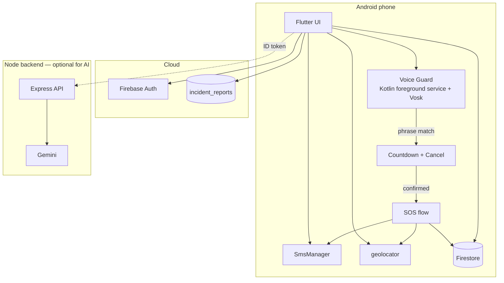
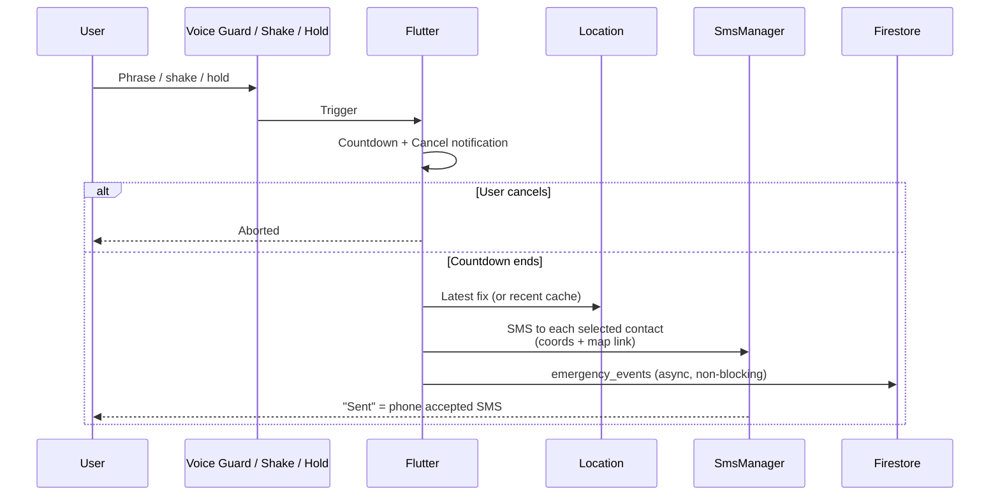
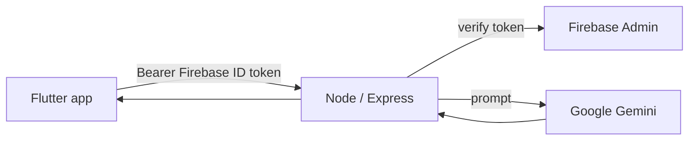

# SafeHer

**Android women's safety app** — hands-free SOS by voice phrase, shake, or hold button. Sends SMS alerts with the latest available location and a map link to your emergency contacts.

> College field project. Critical SOS paths are designed to work with weak or missing internet. Nothing contacts police or emergency services automatically.

---

## What it does

| Feature | Description |
|--------|-------------|
| **Voice Guard** | Offline phrase detection (Vosk) via a Kotlin foreground service — works with the screen off |
| **Shake / Hold SOS** | Alternate triggers when speaking is not possible |
| **SOS SMS** | Sends map link + coordinates via device SIM (`SmsManager`) to selected contacts |
| **Countdown + Cancel** | Short cancellable countdown before SMS, including from the notification when locked |
| **Call 112** | One-press button that opens the phone dialer (no automatic call) |
| **Share location** | One-tap SMS or WhatsApp pre-fill to contacts |
| **Hazard / incident reports** | Community reports on the map and along routes |
| **Route Check** | Walking route + nearby incident counts (depends on free map APIs) |
| **Safety Map** | Nearby police, hospitals, support centres + incident pins |
| **Safety tips & plan** | Tips, saved places, medical notes, distress codes (never added to SOS SMS) |
| **AI assistant** | Gemini via a Node backend (requires a hosted server for phone-only use) |

**Important distinctions**

- SOS sends a **snapshot** of the latest available location + map link — **not** continuous live tracking.
- Continuous timed live location sharing is a **separate, incomplete** feature.
- Voice enrollment builds a small acoustic profile for an **informational** match only — it **never** blocks or delays SOS.

---

## Architecture



### SOS data flow



### AI assistant flow (when backend is reachable)



---

## Tech stack

| Layer | Technology |
|-------|------------|
| App | Flutter / Dart, Provider, google_fonts |
| Auth & data | Firebase Authentication, Cloud Firestore |
| Background listening | Kotlin foreground service (microphone + location) |
| Speech | Vosk (offline), `speech_to_text` for Route Check mic only |
| SMS | Android `SmsManager` (device SIM — needs **cellular**, not Wi‑Fi) |
| Location | geolocator |
| Maps | flutter_map, OpenStreetMap tiles, Photon, Nominatim, OSRM, Overpass |
| Notifications | flutter_local_notifications |
| Shake | sensors_plus |
| Backend (AI only) | Node.js, Express, firebase-admin, `@google/genai` |
| Device tested | Vivo V60 (Android 16) |

**Versions** change over time — confirm with `flutter --version`, `dart --version`, and `pubspec.lock` on your build machine.

---

## Project structure (high level)

```
lib/
  screens/          # auth, dashboard, SOS, map, route, safety, assistant, …
  services/         # auth, emergency, voice guard, enrollment, incidents, …
  models/
  widgets/
android/            # Kotlin foreground service, SmsManager bridge, manifest
safeher-backend/    # Express + Gemini (optional for AI)
```

Exact paths and Firestore collections should be confirmed in the repo (`collection(`, `doc(`, `set(`, etc.).

Typical data shape (verify in code and Security Rules):

- `users/{uid}` — profile, phrases, enrollment flags  
- Subcollections under user (as implemented): contacts, emergency events, safety plan  
- Top-level: `incident_reports` (hazard reports)  
- `location_shares` — treat as planned/unused unless an end-to-end flow exists  

---

## Status (honest)

| Area | Status |
|------|--------|
| Release APK | Built and installable for demos |
| Voice Guard / SOS / Cancel / enrollment | Implemented — **re-verify** on your current APK (long run, screen off, backgrounding) |
| Call 112 button | **Implemented** (opens dialer only) |
| Route Check | Unreliable (free external APIs) |
| AI Assistant | Code present; **production backend hosting** still required for phone-only use |
| Timed live location | Incomplete |
| Play Store | Not recommended yet (`SEND_SMS` policy) |

This project should document **what the code does and what you tested**, not earlier agent claims. Re-run device tests after native or Gradle changes (Vosk can break under release shrinking).

---

## Setup

### App

1. Flutter SDK installed and on `PATH`.
2. Clone the repo and open the project root.
3. Configure Firebase (`google-services.json`, `firebase_options.dart`) for your project.
4. `flutter pub get`
5. Connect a device (USB debugging). On some OEMs (e.g. Vivo), enable **Install via USB** and allow **background activity / autostart** for SafeHer.
6. `flutter run` or build a release APK:

```bash
flutter build apk --release
# output: build/app/outputs/flutter-apk/
```

### Backend 


1. `cd safeher-backend` (or your backend folder).
2. Copy `.env.example` → `.env` with Firebase Admin credentials and Gemini API key.
3. `npm install` && start the server (port as in your code, often `5000`).
4. Point the Flutter API base URL at a **reachable** host (not `localhost` from a physical phone unless you tunnel).

```bash
# example
npm start
# or: node server.js
```

### Permissions

- Location, microphone, notifications, SMS as required by the features you enable.
- **SEND_SMS** must be obtainable **before** an emergency — do not rely only on the Share Location screen.
- SMS itself needs a **SIM and cellular signal**, not mobile data or Wi‑Fi.

---

## Safety & design rules

1. **Nothing may delay or block SOS** — voice profile match is informational only.  
2. **Cancellable countdown** before automatic SMS from voice/shake.  
3. **No automatic call to police** — Call 112 opens the dialer; the user confirms.  
4. **Medical / distress codes never go into SOS SMS.**  
5. **No raw enrollment audio retained** — small on-device acoustic profile only.  
6. **“Sent”** means the phone accepted the SMS, not that the recipient received it.  
7. **Hazard reports** are community-sourced, not authority-verified; check Firestore rules before assuming anonymity.

---

## Risk indicator (not ML)

On-device, rule-based score (verify exact formula and capping in code). An experimental ML notebook is **not** served in the app.

---

## Known limitations

- Voice model is small; unusual phrases and noise can fail; distance performance unmeasured.  
- OEM battery savers can kill background listening unless the user allows it.  
- Free map/routing APIs can time out (Route Check).  
- Incident report privacy depends on **current** Security Rules (reporterId / exact coordinates may be visible to signed-in users).  
- AI needs a hosted backend for real phone use.  
- Google Play restricts `SEND_SMS` — sideloaded APK is the realistic demo path.

---

## Testing checklist

Record **date, APK/build id or git commit, device**, and pass/fail:

```bash
flutter analyze
flutter test
flutter build apk --release
```

Device:

- [ ] Phrase detection (repeated), long session, screen off, after backgrounding  
- [ ] Enrollment record / playback / save  
- [ ] SOS SMS on cellular; data off; location off; SMS denied path  
- [ ] Countdown Cancel while locked  
- [ ] Call 112 opens dialer  
- [ ] Hazard report → map / route if implemented  
- [ ] AI only when backend is reachable from the phone  

---

## Deployment notes

- Prefer a **release APK** for demos; re-test after every native change.  
- Host the Express backend over HTTPS if the assistant is part of the demo.  
- Review Firestore Security Rules for every path the app writes/reads.  
- Firebase SHA-1 fingerprints matter for some Auth providers (e.g. Google Sign-In), not necessarily email/password alone.  
- Never ship API keys inside the APK.

---

## Emergency numbers (India — re-verify before any public release)

112 · 100 · 101 · 102 · 108 · 181 · 1091

---

## License / academic use

College field project. Not a certified emergency system. Use and distribute according to your institution’s rules and applicable law.

---

## Contributing / handover

1. Read the **actual** current files before editing — do not assume older chat snippets match the repo.  
2. Avoid running multiple mic consumers at once (Vosk, `speech_to_text`, `record`, TTS).  
3. Never gate SOS on voice verification.  
4. Keep DEMO / honesty labeling for anything that is not a real emergency integration.
