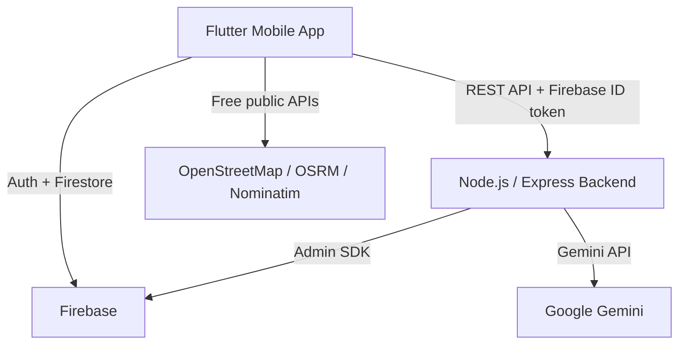

# SafeHer — AI-Powered Women's Safety Mobile Application

A college field project: a real, working Flutter safety app with Firebase auth
and data, a Gemini-powered AI safety assistant, voice-activated hands-free SOS,
live location sharing, community incident reporting, a walking-route safety
check, and a risk indicator informed by real TensorFlow/PyTorch experimentation.

## Overview

SafeHer helps a user respond quickly to an unsafe situation and stay informed
about their surroundings. **Every simulated emergency action is clearly
labeled DEMO MODE** — this is a field-project demonstration of the full
workflow, not a production emergency-dispatch system, and it never claims to
have contacted real emergency services.

## Features

- Firebase Authentication (email/password)
- Press-and-hold SOS with live location capture and demo contact notification
- Voice Guard — hands-free SOS via one or more configurable trigger phrases
- AI Safety Assistant powered by Google Gemini, with a safety-focused system prompt
- Interactive safety map (OpenStreetMap) with community incident markers
- Live location sharing via a shareable, time-bounded link (no recipient account needed)
- Route Check — walking-route safety information cross-referenced against real community incident data
- Loud alarm siren
- Community incident reporting
- Local risk indicator, informed by a real TensorFlow/PyTorch training + evaluation notebook
- Personal safety plan, categorized safety tips, verified Indian emergency resources
- Profile & settings, including account deletion

## Tech stack

| Layer | Technology |
|---|---|
| Mobile app | Flutter / Dart |
| State management | Provider |
| Auth & database | Firebase Authentication, Cloud Firestore |
| Backend | Node.js, Express |
| AI | Google Gemini API |
| Maps & routing | OpenStreetMap, OSRM, Nominatim (via `flutter_map`) |
| ML experimentation | TensorFlow, PyTorch (Google Colab) |

## Architecture



Flutter talks directly to Firebase for most features. The backend exists only
for what shouldn't live in the client: proxying Gemini calls (to protect the
API key) and serving live-location-share pages to recipients who don't have
the app or an account.

## Project structure

```
lib/
  core/        # app-wide config (API base URL)
  models/      # data models
  services/    # Firebase/Firestore/backend service classes
  screens/     # one folder per feature area
  theme/       # centralized design tokens (colors, spacing, radius, type)
  widgets/     # shared reusable widgets
```

## Setup

1. Clone this repo and the companion backend repo (`safeher-backend`).
2. Flutter side: `flutter pub get`, then `flutterfire configure` against your
   own Firebase project (Authentication + Firestore enabled).
3. Backend side: `npm install`, add your own `.env` (see `.env.example`) with
   a Gemini API key, and your own Firebase `serviceAccountKey.json`.
4. Run the backend: `node server.js`
5. Run the app: `flutter run`

Full setup steps, the manual test plan, and current project status are
documented in `CLAUDE.md`, `TEST_PLAN.md`, and `PROJECT_STATUS.md` in this repo.

## Demo mode

No real emergency services, SMS gateways, or push notifications are contacted
by this project. Every simulated action is visibly labeled DEMO MODE — a
deliberate, documented design decision for a field-project demonstration, not
a missing feature.


